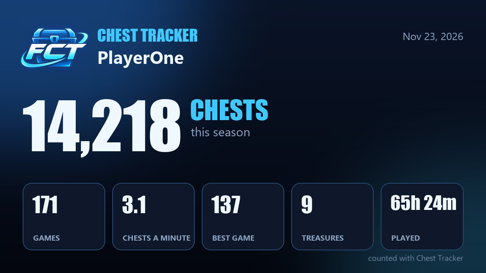
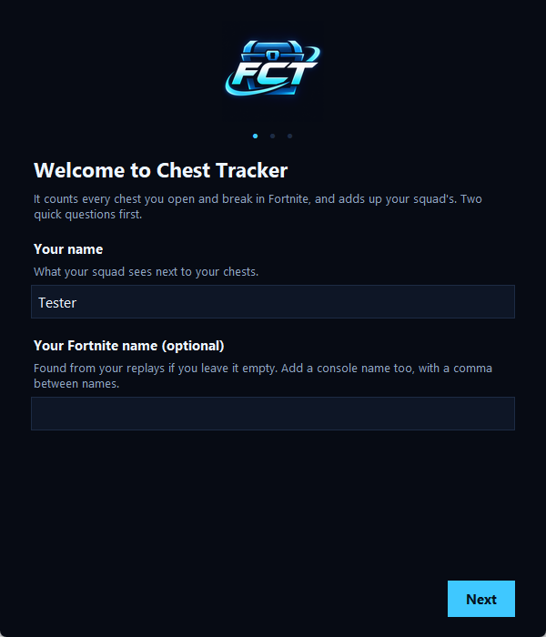
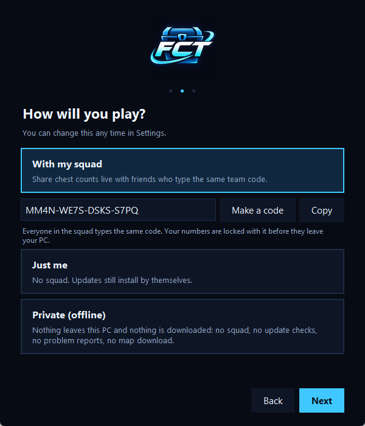
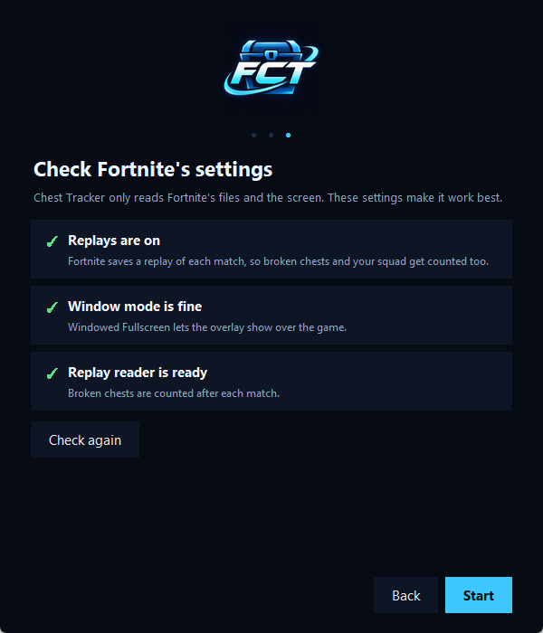

<p align="center"></p>

<h1 align="center">Chest Tracker</h1>

<p align="center">Counts every Fortnite chest you open <b>and break</b>, live, and adds up your whole squad's.<br>
Windows · free · open source · reads only the screen and Fortnite's own files</p>

---

## What it does

- **A small overlay** over the game counts your chests the moment the "Chest +600 XP" pop-up shows.
- **Broken chests count too.** After each match it reads Fortnite's replay of the match. That's where
  chests smashed with a pickaxe or broken with a build show up.
- **Your squad, live.** Friends who type the same team code see everyone's chests this game, today and
  all season. Console teammates without a PC are counted from your replays.
- **Games, map and stats**: every match with its chests, chests a minute, playtime, a heatmap of where
  you loot, the best places to land, replays of each match from above, and treasure hunt prizes.
- **Share my stats**: a picture of your season, copied for Discord with one click.

<p align="center"></p>

## Install

1. Download `ChestTracker.zip` from the [latest release](../../releases/latest) and unzip it somewhere
   you'll keep it, like Documents.
2. Double-click **Start Chest Tracker.bat**. The first time it installs what it needs (Python, and
   Microsoft's .NET SDK to build the replay reader) into your own user folder: no admin prompt, 5-10 minutes.
   If Windows says "Windows protected your PC", click **More info > Run anyway**.
3. A setup window asks your name, how you'll play, and checks Fortnite's settings:

<p align="center">



</p>

In Fortnite, use **Windowed Fullscreen** (regular Fullscreen hides every overlay) and turn on
**Settings > Game > Replays > Record Replays**.

Each start checks this repository's latest release for a newer version and installs it. Updates are signed:
only ones from the publisher's key are installed.

## Privacy and fair play

- **Team messages are locked with your team code** (ChaCha20-Poly1305, key from PBKDF2-SHA256) before they
  leave your PC. The free public relays they travel through only see unreadable bytes. The code itself is
  never sent. "Make a code" makes a strong one.
- **Offline mode** (Settings > Privacy, or "Private" in setup): nothing leaves your PC and nothing is
  downloaded. No squad sync, no update checks, no problem reports, no map download.
- **Problem reports are off** unless you turn them on, and are sealed so only the publisher can read them.
- **Other players' names never leave your PC.** Random squad fills and opponents stay local.
- **No cheating, no hooking.** It never touches Fortnite's memory or network traffic. It reads the screen
  (like OBS) and the files Fortnite saves itself (replays and its log). The live overlay only shows your
  own squad's chests, never other players or unopened chests.

Squadmates' counts are the chests they opened. Chests they broke mostly aren't included, because your replay
only sees the ones broken near you. A squadmate who runs Chest Tracker too shares their own full count instead.

## For developers

```
python -m unittest discover -s tests     # the tests (they never touch your real settings)
node tests/web/crypto_test.mjs ...       # the web page's unlocking (see the file)
python tools/make_release.py             # build dist/ChestTracker.zip + dist/update.json for a release
python tools/make_logo_assets.py         # remake the icons from assets/logo_source.png
```

| Part | What it is |
|---|---|
| `chest_tracker.py` | The app: screen reading, replays, the overlay, squad sync |
| `app_window.py`, `app_theme.py`, `app_model.py` | The Chest Tracker window |
| `map_tracker.py`, `map_window.py` | Live position from the minimap, the map window |
| `teamcrypt.py` | Team-code locking (RFC 8439 / RFC 7748, checked against the RFC test vectors) |
| `launcher.py`, `edition.py` | Updates, start-up checks, public vs personal builds |
| `setup_wizard.py`, `share_card.py` | First-run setup, Share my stats |
| `reader_src/` | The replay reader (C#, built on each PC by `setup_reader.bat`) |
| `web/` | A read-only squad page for phones (static, works on GitHub Pages) |

**Your own fork**: run `tools/make_release.py` once to make your own signing key, put its public half in
`PUBLISHER_KEY` in `launcher.py` and your repository in `GITHUB_REPO` in `edition.py`.

**Personal features**: a `personal/` folder (git-ignored) turns a copy into a personal build. See `edition.py`.
`personal/edition.json` can change where updates come from, and `personal/__init__.py` can add features
that never reach the public code.

## Credits and license

MIT (see `LICENSE`). The replay reader is adapted from rossalv/fortnite-chest-counter (MIT) and uses Shiqan's
FortniteReplayDecompressor (MIT). Map pictures come from fortnite-api.com.

Chest Tracker is a fan-made tool. It isn't made, endorsed or supported by Epic Games. Fortnite is a trademark
of Epic Games, Inc.
